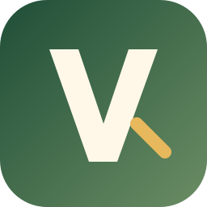
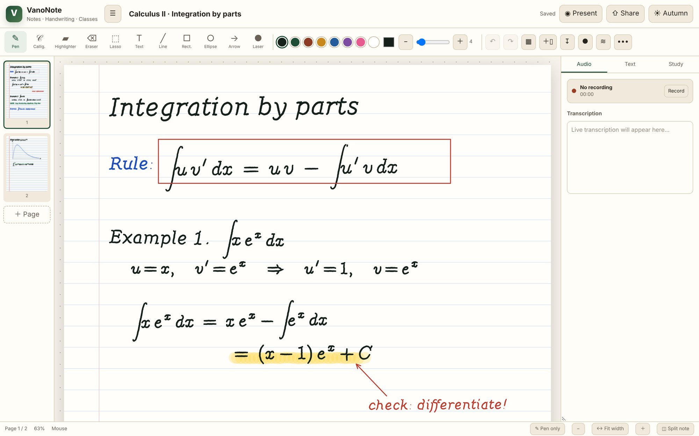
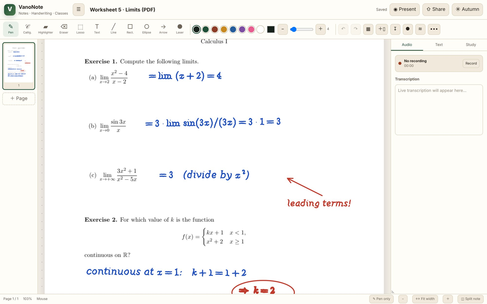
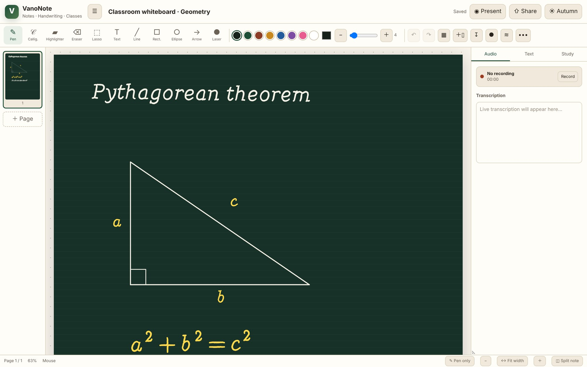
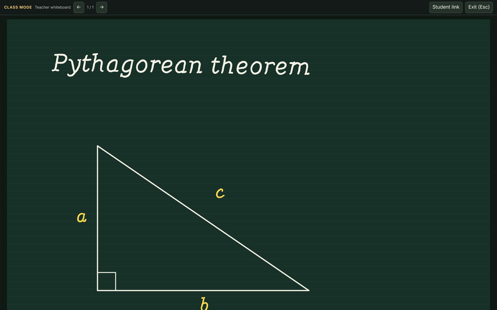
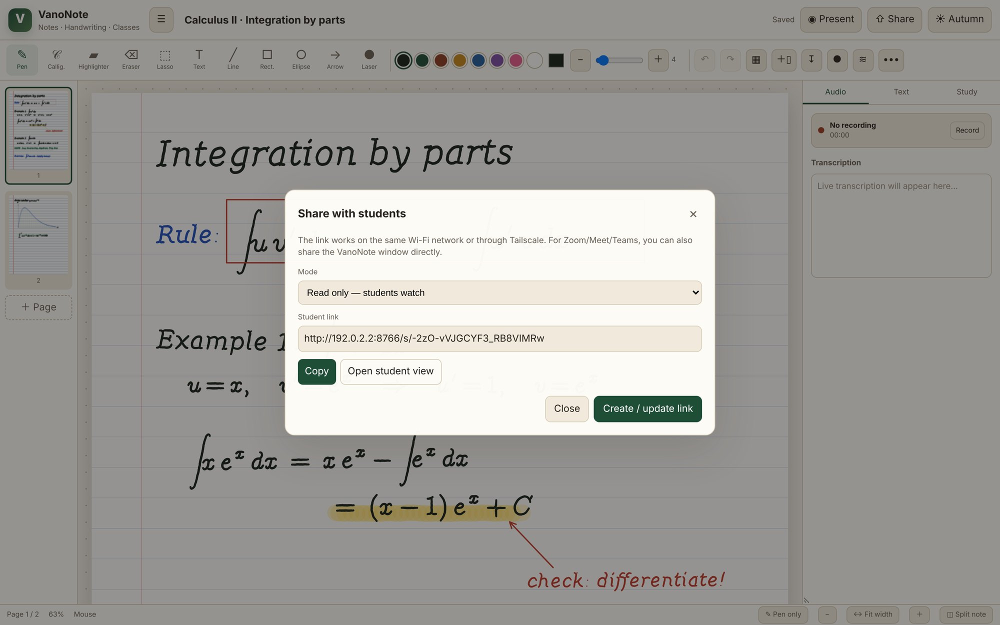
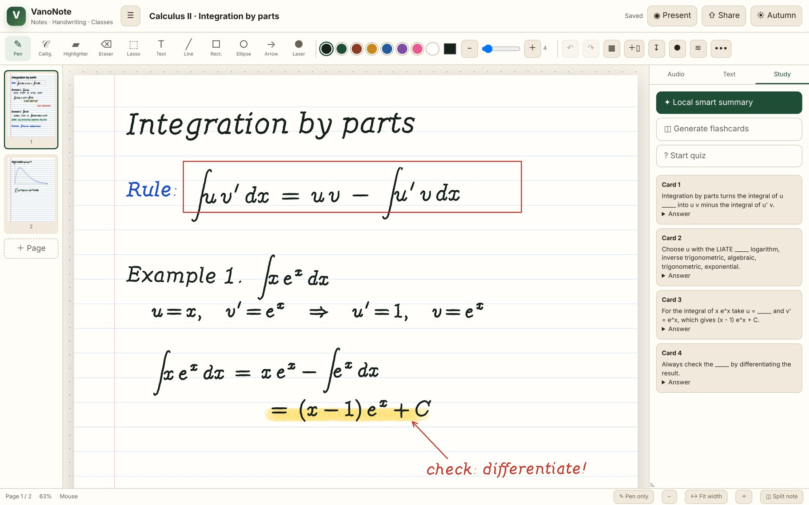
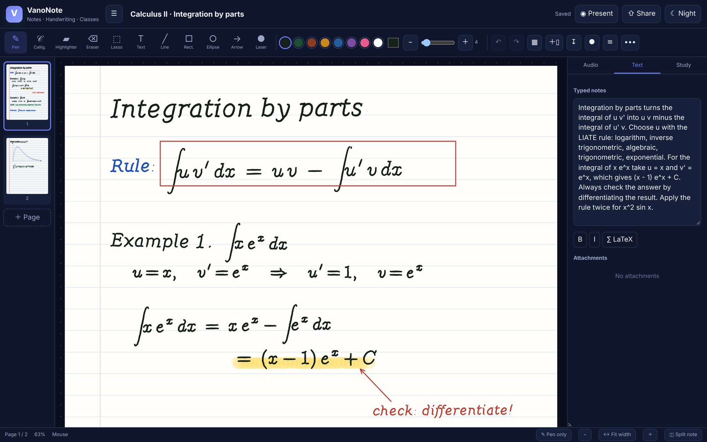
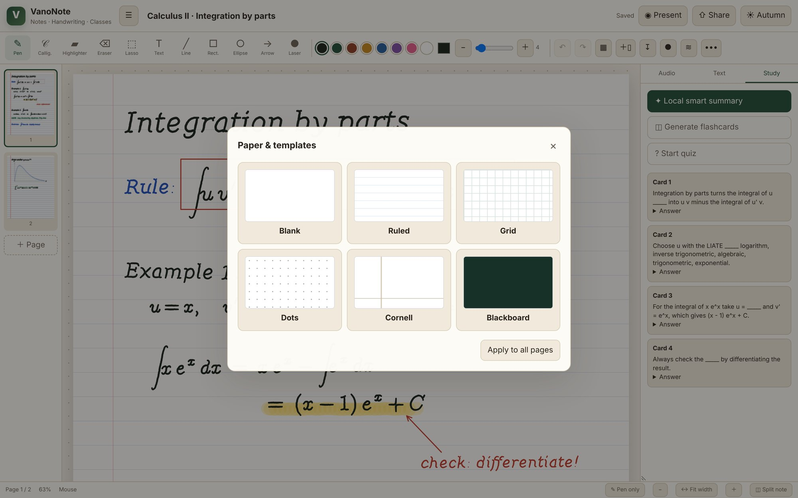
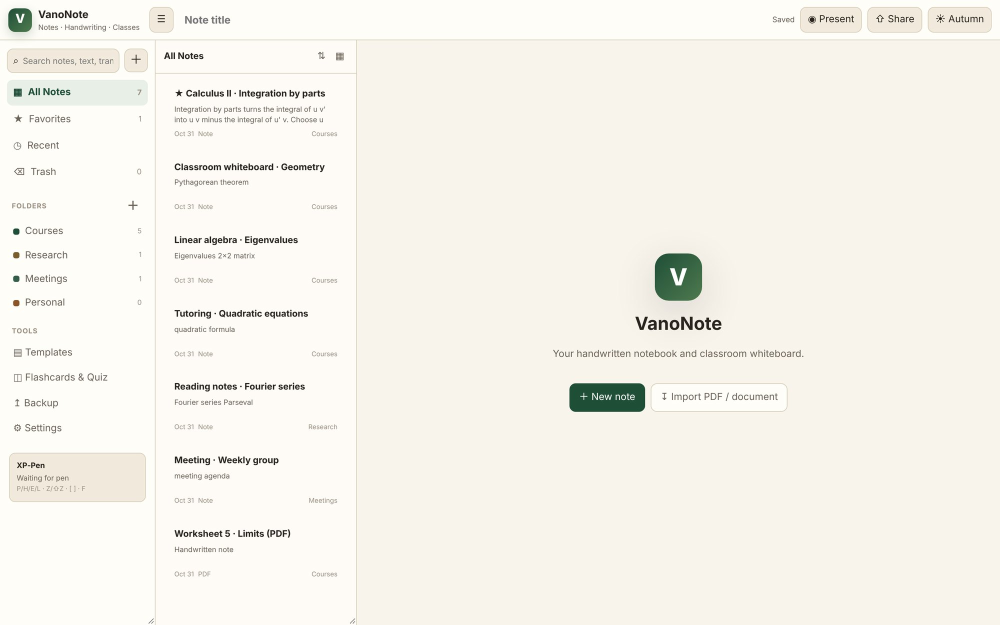

<div align="center">



# VanoNote

**A free, open-source handwritten notebook and classroom whiteboard for your computer.**

Write with a pen tablet or a mouse, annotate PDFs, teach on a blackboard, and share the live page with your students. No account, no subscription, no cloud: your notes stay on your disk.

[](LICENSE)


[Français](README.fr.md) · [Install](#install) · [Features](#features) · [Teaching with VanoNote](#teaching-with-vanonote) · [FAQ](#faq)



</div>

## Why VanoNote

Apps like Notability and Goodnotes are excellent, but their free plans are limited (Goodnotes Free, for example, stops at 3 files) and the full versions are paid, account-based and tied to a cloud. That adds up quickly for the people who need a digital notebook every day: **tutors, teaching assistants, online teachers and students**.

VanoNote was built for exactly that work:

| | VanoNote |
|---|---|
| **Price** | Free, forever. MIT licence. |
| **Account** | None. Nothing to sign up for. |
| **Where your notes live** | A SQLite database in the VanoNote folder on your own computer. |
| **Platforms** | macOS, Windows and Linux (it runs in your browser, served by a small local Python server). |
| **Pen tablets** | XP-Pen, Wacom, Huion and any tablet that reports pressure to the browser. A mouse or trackpad works too. |
| **Teaching** | Full-screen presentation mode, blackboard paper, laser pointer, and a live link students open on the same Wi-Fi. |
| **Footprint** | One Python file, one HTML page, one script. Only optional dependency: PyMuPDF for PDF import. |

## Features

<table>
<tr>
<td width="50%"></td>
<td width="50%"></td>
</tr>
<tr>
<td><b>Annotate PDFs and slides.</b> Import a PDF, an image, or a Word or PowerPoint file and write directly on its pages.</td>
<td><b>Blackboard and five other papers.</b> Blank, ruled, grid, dots, Cornell and blackboard, per page or for the whole note.</td>
</tr>
<tr>
<td></td>
<td></td>
</tr>
<tr>
<td><b>Presentation mode.</b> One key (<code>F</code>) turns the page into a full-screen whiteboard for Zoom, Meet, Teams or a projector.</td>
<td><b>Live link for students.</b> Students follow the page in their browser, read-only or collaborative. No install on their side.</td>
</tr>
<tr>
<td></td>
<td></td>
</tr>
<tr>
<td><b>Study tools.</b> A summary, fill-in-the-blank flashcards and a quiz built from your typed notes and transcript, entirely offline.</td>
<td><b>Typed notes and themes.</b> A text pane with bold, italic and LaTeX snippets next to the ink, in Autumn, Night or Quantum.</td>
</tr>
</table>

**Writing**
- Pressure-sensitive pen, calligraphy pen, highlighter, eraser and laser pointer
- Lasso selection, text boxes, lines, rectangles, ellipses and arrows
- Color palette, custom colors, adjustable size, undo and redo
- Multi-page notebooks with page thumbnails
- *Pen only* mode so that your palm, mouse or trackpad never draws by accident

**Organizing**
- Folders, favorites, recent notes and a trash you can restore from
- Search across titles, typed text and transcripts
- List or grid library, sorting, and *Split note* to keep a reference note open beside the one you are writing
- Version history with one-click restore

**Audio**
- Record audio while you write; files are saved in the `audio/` folder
- Live transcription with the browser's speech recognition (Chrome or Edge)

**Your data**
- Automatic backups every 6 hours (the last 20 are kept) and manual backups you can download
- Export a note as a `.vnote` file and import it on another computer
- Print or save any note as PDF

<p align="center"> </p>

## Install

**macOS or Linux**, in a terminal:

```bash
curl -fsSL https://raw.githubusercontent.com/yassine-aitmohamed/VanoNote/main/install.sh | bash
```

**Windows**, in PowerShell:

```powershell
irm https://raw.githubusercontent.com/yassine-aitmohamed/VanoNote/main/install.ps1 | iex
```

The installer downloads VanoNote to `~/VanoNote`, creates a private Python environment, installs PyMuPDF for PDF import, adds a shortcut to your Desktop and opens the app at <http://localhost:8766>. Python 3.9 or newer is required; on Windows the installer offers to install it with `winget`.

To install somewhere else, set `VANONOTE_DIR` before running the command.

<details>
<summary><b>Manual install</b></summary>

```bash
git clone https://github.com/yassine-aitmohamed/VanoNote.git
cd VanoNote
python3 -m venv .venv
.venv/bin/pip install -r requirements.txt     # Windows: .venv\Scripts\pip install -r requirements.txt
./start.command                               # Windows: start.bat
```

VanoNote also runs with no dependency at all (`python3 vanonote.py`); only PDF import needs PyMuPDF. Importing Word and PowerPoint files needs [LibreOffice](https://www.libreoffice.org/).

</details>

**Tip:** in Chrome or Edge, use *Install VanoNote* from the address bar to get a standalone window with its own icon in the Dock or taskbar.

## Teaching with VanoNote

1. Open a note and choose the **blackboard** or **grid** paper from the paper button in the toolbar.
2. Press **Present** (or `F`) for a full-screen whiteboard. Share that window in Zoom, Meet or Teams, or put it on the projector.
3. To let students follow on their own devices, press **Share**, choose *Read only* or *Collaborative*, then **Create link**. Anyone on the same Wi-Fi network (or the same [Tailscale](https://tailscale.com) network) opens the link in a browser.
4. Use the **laser** (`L`) to point without leaving marks, and `←` / `→` to change pages.

## Keyboard shortcuts

These are also convenient to map to the buttons of a pen tablet.

| Key | Action | Key | Action |
|---|---|---|---|
| `P` | Pen | `T` | Text |
| `H` | Highlighter | `C` | Calligraphy |
| `E` | Eraser | `Z` / `Shift+Z` | Undo / Redo |
| `L` | Laser | `[` / `]` | Smaller / larger |
| `V` | Lasso | `F` | Presentation mode |
| `←` / `→` | Previous / next page (presentation) | `Esc` | Leave presentation |
| `Delete` | Delete the lasso selection | `Y` | Redo |

## Privacy

VanoNote runs entirely on your computer. Notes, attachments, audio and backups are stored in the VanoNote folder (`data/`, `attachments/`, `audio/`, `backups/`). There are no accounts, no analytics and no external requests.

The server listens on your local network so that students can open a shared link. Every private endpoint (your library, your notes, editing, backups) answers only to the computer running VanoNote; another device can reach a note only through a share link you created, and you can disable that link at any time. Live transcription uses your browser's speech recognition service.

## FAQ

**Does it work on an iPad?**
VanoNote runs on a computer. An iPad on the same Wi-Fi can open a shared link in Safari, which is ideal for students following a lesson.

**Can I move my notes to another computer?**
Yes. Copy the whole VanoNote folder, or download a backup from *Backup* and unzip it into the new installation. Single notes can be exported as `.vnote`.

**Port 8766 is already in use.**
VanoNote is probably already running: open <http://localhost:8766>.

**PDF import says PyMuPDF is missing.**
Run the installer again, or `pip install PyMuPDF` inside the `.venv`.

## Project structure

```
vanonote.py        local server, SQLite storage, PDF rendering, sharing, backups
index.html         the interface
assets/app.js      ink engine, tools, library, study and classroom features
assets/app.css     themes and layout
install.sh / .ps1  one-command installers
start.command/.bat launchers
```

## Contributing

Issues and pull requests are welcome. If you teach or tutor with VanoNote, tell us what is missing in your lessons: that is what shapes the next version.

## License

[MIT](LICENSE). Free to use, modify and share, in class or anywhere else.
